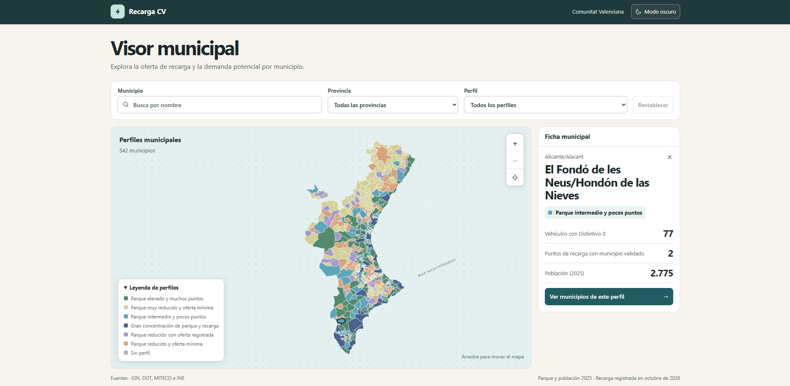
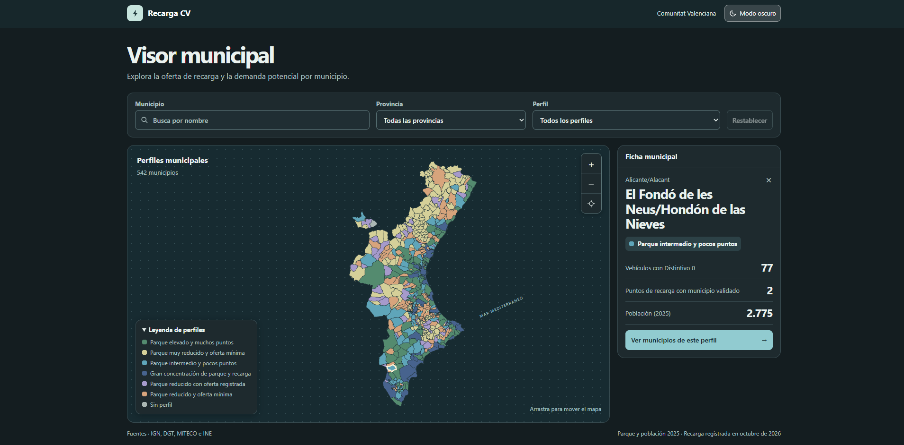

# Entrega 04 - Diseño del frontal y experiencia de usuario

## 1. Utilidad y valor del producto

El visor se dirige a una persona responsable de planificar infraestructura pública de recarga en la Comunitat Valenciana. Su tarea consiste en decidir qué municipios o regiones estudiar primero al valorar una posible ampliación de la oferta. Consultar las cifras de parque y recarga por separado dificulta reconocer qué municipios presentan combinaciones parecidas.

El mapa reúne ambos indicadores en seis perfiles descriptivos. El usuario puede localizar un municipio, ver sus cifras y explorar otros del mismo grupo. Los perfiles ayudan a justificar qué casos examinar con más detalle. La intención no es decidir si hace falta ampliar la oferta en un lugar concreto, para ello se necesitan además datos de potencia, uso y disponibilidad operativa.

## 2. Flujo de usuario

1. **Explorar el territorio.** Al abrir el visor, se muestran los municipios de la Comunitat Valenciana con una leyenda de perfiles. Al pasar el puntero por un recinto, se leen el nombre y el perfil del municipio.
2. **Localizar un municipio.** El usuario puede seleccionarlo en el mapa o buscarlo por nombre. Las sugerencias respetan los filtros de provincia y perfil y se pueden recorrer con las flechas del teclado.
3. **Interpretar la ficha.** La selección resalta el municipio y abre una ficha con su provincia, perfil, vehículos con Distintivo 0, puntos de recarga con municipio validado y futuros datos que todavía están en valoración. Cuando hay un aviso relevante, aparece junto a las cifras.
4. **Explorar casos parecidos.** «Ver municipios de este perfil» aplica el filtro correspondiente y abre las sugerencias del buscador. El filtro queda visible y se puede quitar con «Restablecer».

Por ejemplo, El Fondó de les Neus/Hondón de las Nieves aparece en el perfil «Parque intermedio y pocos puntos». Su ficha muestra 77 vehículos con Distintivo 0, 2 puntos de recarga con municipio validado y 2.775 habitantes. Desde ahí se pueden localizar otros municipios del mismo perfil y consultar sus cifras para valorar cuáles merece la pena estudiar.

## 3. Diseño del frontal

El mapa ocupa la mayor parte de la pantalla porque la tarea empieza por situar los municipios. El buscador y los filtros quedan encima, la leyenda acompaña el mapa y la ficha lateral permite consultar las cifras manteniendo visible la selección. El [visor cartográfico de la Generalitat](https://visor.gva.es/visor/?idioma=es) sirvió de referencia para combinar la búsqueda de topónimos y la navegación sobre el mapa.

La primera versión permite alternar entre un modo claro, con la paleta Piedra y Mediterráneo, y un modo oscuro. Los colores de los perfiles se conservan en ambos temas para que las categorías sigan siendo reconocibles al cambiar de apariencia.

*Figura 1. Vista principal en modo claro.*

*Figura 2. Vista principal en modo oscuro.*

## 4. Experiencia de usuario

- **Consulta y selección.** El mapa ofrece una entrada territorial y el buscador permite ir directamente a un municipio, incluso si se escribe sin tildes o se usa otra variante de su nombre. Integrar la lista en un desplegable deja espacio para el mapa y la ficha. El contorno de selección y la actualización de la ficha muestran el efecto de la acción.
- **Lectura de los perfiles.** Los colores distinguen categorías sin orden de prioridad. Las etiquetas aparecen también como texto en la leyenda, las sugerencias y la ficha. Los recuentos permiten interpretar qué hay detrás de cada etiqueta, y la población aporta contexto sobre el tamaño del municipio.
- **Filtros y recuperación.** Al escribir o cambiar un filtro se actualiza el número de coincidencias. El mapa atenúa los municipios descartados para conservar la referencia territorial. Si no hay coincidencias, el visor lo indica y permite modificar la búsqueda o restablecer los filtros.
- **Datos inciertos y ausencias.** La ficha distingue un cero de un dato no disponible y muestra un aviso cuando una incidencia afecta a la lectura. Albatera tiene 10 puntos con municipio validado y una instalación relacionada cuya asignación municipal está pendiente. Puebla de San Miguel figura como «Sin perfil» y conserva sus cifras, incluidos los 0 puntos validados en la copia utilizada. Su parque domiciliado se consideró poco representativo de la demanda local y el municipio quedó excluido de la segmentación.

Estos recorridos se comprobaron en el prototipo con los tres municipios citados. Queda por observar si las etiquetas y los avisos ayudan al personal destinatario a elegir qué municipios estudiar.

## 5. Continuidad hacia el MVP final

El MVP mantendrá el recorrido ya implementado en el prototipo navegable. Para la presentación final quedan la verificación de la ejecución con las entradas documentadas y la revisión del recorrido desde la perspectiva del usuario destinatario. La comparación simultánea de fichas, los marcadores de instalaciones y el gráfico de dispersión quedan como posibles ampliaciones.

El visor parte de la capa `gold_municipios` de la [Entrega 02](02_datos_y_preparacion.md), que aporta los 542 recintos y las cifras municipales. Por código municipal añade las 541 asignaciones precalculadas de K-means de la [Entrega 03](03_machine_learning.md#5-decisión-y-uso-en-el-producto). La población se utiliza como contexto de la ficha. Los agrupamientos se calcularon a partir del parque con Distintivo 0 y de los puntos de recarga con municipio admitido.

El [exportador del frontal](../../desarrollo/frontal/exportar.py) comprueba la cobertura, la unicidad de los códigos y la coincidencia de los recuentos antes de generar el JSON que consume el navegador. La copia de la entrega incluye el JSON de consulta, de modo que el visor se puede abrir con Python 3 siguiendo las [instrucciones de arranque](../../desarrollo/frontal/README.md).
