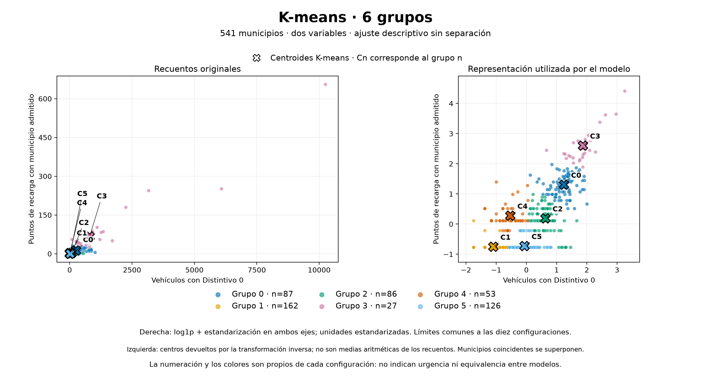

# Resultados del proyecto

La carpeta `informes/` contiene la selección incluida en Git: esquemas,
recuentos, métricas agregadas y figuras de las ejecuciones vigentes. Permite
revisar los resultados sin descargar las bases completas ni ejecutar los modelos.

## Preparación de datos

Ejecución `20261022T150925140929Z`: 48 tablas Silver y 13 Gold.

- [Inventario de tablas](informes/preparacion/resumen_tablas.csv): capa,
  bloque, filas, número de columnas y claves.
- [Esquemas y claves](informes/preparacion/esquemas.json).
- [Estado, entorno y limitaciones](informes/preparacion/resumen.json).

Los informes describen las tablas preparadas; no incluyen sus registros,
coordenadas ni geometrías. Las tablas completas permanecen en las carpetas
locales de datos.

## Segmentación descriptiva vigente

Se describen 541 municipios mediante vehículos con Distintivo 0 y puntos de
recarga con municipio admitido, con `log1p` y estandarización. No hay reserva de
prueba ni validación cruzada en este diseño.

| Ejecución | Referencia | Resultado |
| --- | --- | --- |
| Baseline `20261111T160303732930Z` | Mediana de Distintivo 0 y oferta cero/positiva | Cuatro perfiles; silhouette interna 0,3816 |
| Comparación `20261111T161605225327Z` | K-means y GMM, de dos a seis grupos | Diez configuraciones y 160 ajustes registrados |
| Selección de trabajo, 13-11-2026 | K-means con seis grupos | Silhouette interna 0,4786; aceptación provisional hasta comprobar utilidad en el MVP |

- [Comparación de métricas](informes/modelado/comparacion.csv).
- [Resumen de perfiles del baseline](informes/modelado/perfiles_baseline.csv).
- [Resumen de perfiles de las diez configuraciones](informes/modelado/perfiles_modelos.csv).
- [Diseño y parámetros del experimento](informes/modelado/protocolo.json).
- [Resumen del baseline, selección posterior y límites](informes/modelado/resumen.json).
- Informes numéricos independientes conservados de las ejecuciones:
  [baseline](informes/modelado/verificacion_baseline.json) y
  [comparación](informes/modelado/verificacion_comparacion.json).

La decisión de trabajar con seis grupos es posterior a los experimentos. Se
documenta en el resumen sin modificar los manifiestos originales, que reflejan
el momento de su ejecución.

Las métricas son internas y de robustez; no estiman rendimiento en municipios
o periodos nuevos. Los perfiles no indican prioridad, necesidad real, suficiencia
de recarga ni viabilidad de conexión eléctrica.

### Figuras con centros

Copias exactas de la exportación `20261111T170051625718Z`, realizada a partir de
asignaciones y modelos guardados. No se han repetido los ajustes. Las dos vistas
muestran recuentos originales y la representación utilizada por el modelo.

| Grupos | K-means | GMM |
| --- | --- | --- |
| 2 | [Figura](informes/modelado/imagenes/kmeans_k2.png) | [Figura](informes/modelado/imagenes/gmm_k2.png) |
| 3 | [Figura](informes/modelado/imagenes/kmeans_k3.png) | [Figura](informes/modelado/imagenes/gmm_k3.png) |
| 4 | [Figura](informes/modelado/imagenes/kmeans_k4.png) | [Figura](informes/modelado/imagenes/gmm_k4.png) |
| 5 | [Figura](informes/modelado/imagenes/kmeans_k5.png) | [Figura](informes/modelado/imagenes/gmm_k5.png) |
| 6 | [Figura](informes/modelado/imagenes/kmeans_k6.png) | [Figura](informes/modelado/imagenes/gmm_k6.png) |



Los números y colores son propios de cada configuración. Los centros de GMM
son medias de componentes; la transformación inversa de un centro no equivale
a la media aritmética de los recuentos de sus miembros.

**Fuentes de las figuras y métricas:** DGT, datos municipales de 2025, y MITECO,
registro de recarga pública, copia adquirida el 18-10-2026. Elaboración propia.
Acceso, versiones, atribuciones y transformaciones documentados en el
[catálogo de fuentes](../config/catalogo_bronze.json) y la
[Entrega 2](../docs/entregas/02_datos_y_preparacion.md).

## Organización de las salidas locales

Las siguientes carpetas conservan sus rutas porque las utilizan los productores
o aparecen en manifiestos de ejecuciones anteriores:

| Ruta | Contenido local |
| --- | --- |
| `bronze/`, `silver/`, `gold/` | Manifiestos y preparaciones por etapa. |
| `entrega02/` | Ejecuciones completas del flujo de preparación. |
| `modelado/` | Experimentos vigentes y antecedentes, con sus modelos y asignaciones. |
| `revision_recarga/` | Evidencias y decisiones utilizadas en la preparación. |
| `investigacion_datum_miteco/`, `investigacion_ide/` | Acreditación de metadatos utilizada por el flujo. |
| `diseno_particiones/` | Recuentos utilizados para definir bloques espaciales conservados. |
| `codigo_historico/` | Versiones exactas de productores anteriores, identificadas por huella. |

El material auxiliar se agrupa en `apoyo/`: `auditorias/`, `diseno/`,
`investigacion/`, `preparacion/`, `mantenimiento/` y `registros/`. Se conserva
localmente, sin incorporar a Git las descargas, bases de trabajo, registros
de ejecución o copias de mantenimiento.

## Reproducir la selección visible

Desde la raíz del proyecto:

```console
python -m src.exportar_resultados
```

El exportador usa una lista cerrada de archivos y extrae únicamente los campos
de los resúmenes. No copia bases completas, asignaciones municipales ni modelos.
Necesita las ejecuciones locales identificadas más arriba.

[procedencia.json](informes/procedencia.json) registra las rutas relativas y
huellas SHA-256 de los insumos y los informes, además de la versión del exportador.
Los CSV de métricas y las figuras son copias exactas; los esquemas, el protocolo
resumido y los resúmenes JSON se extraen de los manifiestos y resultados guardados.
La selección provisional se registra como decisión posterior explícita.
