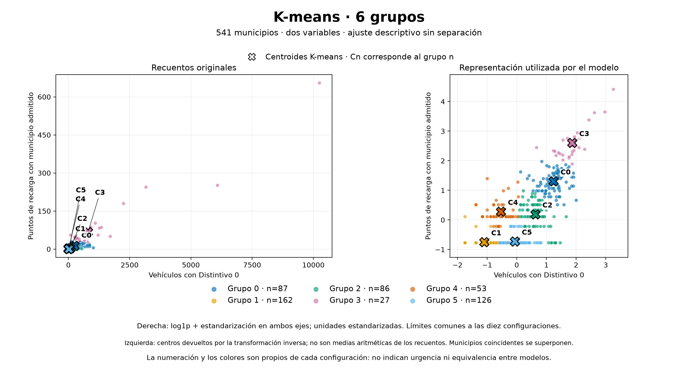

# Resultados de la Entrega 03: perfiles de demanda y oferta

## Resumen

Se continúa con **K-means de seis grupos como solución provisional**. Frente al
baseline, la silhouette interna pasa de **0,3816 a 0,4786** y los municipios con
silhouette negativa bajan de **85 a 3**. El detalle adicional permite diferenciar
municipios con pocos puntos registrados pero parques domiciliados distintos.
La mejora no es uniforme: el ARI espacial medio baja de 0,9576 a 0,9550 y el ARI
al retirar municipios con avisos, de 0,9043 a 0,8627.

Estas cifras describen la geometría y robustez de una fotografía de **541
municipios**. No son resultados fuera de entrenamiento ni acreditan necesidad
real de cargadores. La comprensión y utilidad de los seis perfiles para el MVP
siguen pendientes de comprobar. La definición del problema, las etiquetas y la
salida para el producto están en la [Entrega 03](../../../docs/entregas/03_machine_learning.md).
Los valores del baseline y la decisión posterior se conservan también en el
[resumen de datos](resumen.json); las alternativas, en el [CSV de comparación](comparacion.csv).

## Métricas y comparación con el baseline

Todas las configuraciones describen los mismos 541 municipios con dos entradas:
vehículos con Distintivo 0 y puntos de recarga con municipio admitido. Las
distancias se calculan tras `log1p` y estandarización. Se utiliza Gold
`20261020T153200478279Z`: parque a 31-12-2025 y recarga adquirida el 18-10-2026.
Se excluye Puebla de San Miguel (46201); Gold conserva sus 542 municipios.

La silhouette resume cohesión y separación; cuanto mayor, mejor según esa
geometría. El ARI compara particiones de los mismos municipios admitiendo cambios
en la numeración de grupos; valores próximos a uno indican más semejanza, no
un porcentaje de aciertos. La robustez se estudia con diez omisiones espaciales,
cuatro semillas adicionales y un reajuste sin los 63 municipios con avisos,
comparado sobre los 478 restantes. Las omisiones reasignan los 541 municipios,
incluidos los utilizados al ajustar: no son validación cruzada.

| Solución | Silhouette interna | Casos negativos | ARI espacial medio | ARI espacial mínimo | ARI semillas mínimo | ARI sin avisos |
| --- | ---: | ---: | ---: | ---: | ---: | ---: |
| Baseline, 4 perfiles | 0,3816 | 85 | 0,9576 | 0,8920 | No aplica | 0,9043 |
| K-means, 2 grupos | 0,5686 | 1 | 0,9254 | 0,8613 | 1,0000 | 0,8510 |
| K-means, 3 grupos | 0,4667 | 14 | 0,9853 | 0,9625 | 1,0000 | 0,8869 |
| K-means, 4 grupos | 0,4452 | 4 | 0,9536 | 0,8488 | 1,0000 | 0,8363 |
| K-means, 5 grupos | 0,4580 | 4 | 0,9639 | 0,7142 | 1,0000 | 0,7860 |
| **K-means, 6 grupos** | **0,4786** | **3** | **0,9550** | **0,8784** | **0,9611** | **0,8627** |
| GMM, 2 componentes | 0,4644 | 62 | 1,0000 | 1,0000 | 1,0000 | 1,0000 |
| GMM, 3 componentes | 0,4175 | 42 | 0,9894 | 0,9783 | 1,0000 | 0,9749 |
| GMM, 4 componentes | 0,3912 | 45 | 0,9034 | 0,6940 | 0,8911 | 0,9259 |
| GMM, 5 componentes | 0,2796 | 96 | 0,9529 | 0,8862 | 1,0000 | 0,9878 |
| GMM, 6 componentes | 0,3958 | 52 | 0,5715 | 0,4669 | 0,5253 | 0,4755 |

**Fuente:** [comparación completa](comparacion.csv) y [baseline](resumen.json).
Las once soluciones principales cubren el 100 % del universo incluido. El
baseline completa 12 ajustes; las diez configuraciones ML, 160 en total.
El [protocolo](protocolo.json) conserva los métodos y parámetros utilizados.

### Qué aporta la solución elegida

El baseline cruza vehículos inferiores o iguales a la mediana (20) frente a
superiores, y cero puntos frente a algún punto. Sus cuatro perfiles contienen
219, 54, 65 y 203 municipios, respectivamente. Es claro y reproducible, pero
su perfil de parque superior y oferta positiva reúne entre 21 y 10.246 vehículos
y entre 1 y 655 puntos. Los [perfiles del baseline](perfiles_baseline.csv)
permiten consultar tamaños, medianas y avisos.

K-means k6 distingue G4 —53 municipios, medianas de 9 vehículos y 2 puntos— de
G2 —86 municipios, medianas de 74,5 vehículos y 2 puntos—. Sus seis grupos
contienen entre 27 y 162 municipios. Las medianas resumen tendencias; no son
fronteras ni aseguran que cada miembro se parezca al caso típico. Los valores
completos están en los [perfiles de las diez configuraciones](perfiles_modelos.csv).

La X representa el centro guardado por el modelo. Su transformación inversa no
es una media aritmética de los recuentos. Los números y colores no indican
prioridad. Fuente: DGT 2025 y MITECO, copia de 18-10-2026; elaboración propia.
La figura procede de las asignaciones y el modelo guardados, sin reajuste.

K-means k2 obtiene mayor silhouette, pero solo distingue dos conjuntos amplios.
K-means k5 conserva mayor estabilidad espacial media y entre semillas que k6;
k6 mejora frente a k5 silhouette, mínimo ARI espacial y sensibilidad sin avisos,
y añade el contraste entre parques con pocos puntos. Se elige ese detalle como
hipótesis de utilidad, sin afirmar que seis sea el óptimo universal.

GMM k2 reproduce exactamente la separación entre 284 municipios sin puntos y
257 con puntos: su estabilidad perfecta no demuestra una descripción más útil
del parque. GMM k5 mantiene juntos los 284 ceros, con parques de 0 a 377 vehículos.
GMM utiliza ambas entradas; esta estructura resulta menos adecuada para la
lectura conjunta buscada, sin implicar que ignore una variable.

## Casos fronterizos, fallos y limitaciones relevantes

### Tres municipios merecen revisar la representatividad de su etiqueta

No se conocen clases verdaderas de necesidad con las que contar errores de
clasificación. Una silhouette negativa indica que la distancia media a su
grupo supera la distancia media a algún otro grupo. En k6 ocurre en estos casos:

| Municipio | Código | Grupo | Vehículos Distintivo 0 | Puntos admitidos | Silhouette |
| --- | --- | --- | ---: | ---: | ---: |
| Ondara | 03095 | G3 | 85 | 55 | −0,0014 |
| Agullent | 46004 | G2 | 41 | 1 | −0,0142 |
| Ayora | 46044 | G2 | 40 | 1 | −0,0321 |

**Fuente:** filas de `kmeans_k6` en `asignaciones_municipales.csv` de la comparación
de referencia; también recogidas en el [apartado 4 de la entrega](../../../docs/entregas/03_machine_learning.md#casos-fronterizos-y-limitaciones-relevantes).
Ondara pertenece al perfil de gran concentración por la combinación de ambas
entradas, aunque sus 85 vehículos quedan lejos de la mediana de 790 de G3.
Agullent y Ayora muestran fronteras dentro del perfil de parque intermedio y
pocos puntos. Estos casos aconsejan acompañar la etiqueta con las cantidades
propias del municipio; no permiten diagnosticar una carencia de recarga.

### La estabilidad y la convergencia tienen límites distintos

Los 160 ajustes terminan sin avisos de ejecución y los 80 GMM declaran
convergencia. Sin embargo, GMM k6 presenta solo cinco grupos de asignación máxima
en tres réplicas: omisiones espaciales 3 y 4 y semilla adicional 3. Sus ARI son
también los más débiles. En los GMM principales una dirección de covarianza
alcanza el suelo de regularización de 10⁻⁶. Convergencia numérica y utilidad de
los grupos deben valorarse por separado.

K-means k6 es sensible al conjunto descrito: su ARI sin avisos es 0,8627 y su
mínimo entre semillas, 0,9611. La nube presenta una tendencia creciente y muchos
ceros, sin seis islas inequívocas. Los grupos resumen volumen conjunto; cambiar
k desplaza fronteras y no produce una jerarquía exacta.

### Los avisos y las aproximaciones limitan la interpretación

Hay 63 municipios con avisos de calidad. De los 284 sin puntos admitidos, 12
tienen avisos. Un cero significa ausencia de puntos admitidos en esta versión,
no ausencia física certificada. Retirar esos municipios y reajustar mide
sensibilidad; no corrige registros inciertos ni acredita integridad del resto.

El parque domiciliado no mide demanda efectiva de recarga pública, visitantes
o vehículos de paso. Contar puntos tampoco acredita potencia, disponibilidad o
funcionamiento. Las dos entradas corresponden a fechas distintas. Los perfiles
no calculan prioridad, cargadores necesarios, suficiencia ni viabilidad eléctrica.
Su aceptación para el producto requiere revisar casos y comprobar que una
persona comprenda los perfiles, especialmente la diferencia G2/G4, frente al
baseline y a k5.

## Evidencia y reproducción

Los informes de verificación independiente del [baseline](verificacion_baseline.json)
y la [comparación](verificacion_comparacion.json) respaldan los cálculos: 541 y
10.190 silhouettes recalculadas, respectivamente, y 11 y 160 ARI por contingencias.
En ML se contrastan las predicciones de los diez modelos principales; los errores
máximos son inferiores a 3,04×10⁻⁹ en silhouette y 1,12×10⁻¹⁶ en ARI; el error
de preparación es cero.
Son comprobaciones técnicas, no pruebas de generalización o usabilidad.

| Evidencia local completa | Ejecución de referencia |
| --- | --- |
| Gold municipal de la Entrega 02 | `resultados/gold/contexto_municipal/20261020T153200478279Z/` |
| Baseline | `resultados/modelado/baseline_descriptivo/20261111T160303732930Z/` |
| Comparación ML y asignaciones de casos fronterizos | `resultados/modelado/comparacion_descriptiva/20261111T161605225327Z/` |
| Imágenes con centros, dentro de la comparación | `imagenes_clusters/20261111T170051625718Z/` |

Desde la raíz del proyecto y con las copias locales y el entorno del
[README](../../../README.md), `python -m src.modelado --verificar` comprueba las
ejecuciones de referencia sin entrenar. `python -m src.modelado` reproduce
baseline, comparación y figuras en carpetas nuevas. El director no sustituye
la selección publicada ni este informe por los resultados de una nueva ejecución.

Los CSV, JSON y figuras enlazados aportan evidencia descargable con funciones
distintas; [procedencia.json](../procedencia.json) identifica sus fuentes y
huellas. Este documento es la síntesis interpretativa revisada de esas evidencias.
Las bases, asignaciones completas y modelos permanecen fuera de Git.
